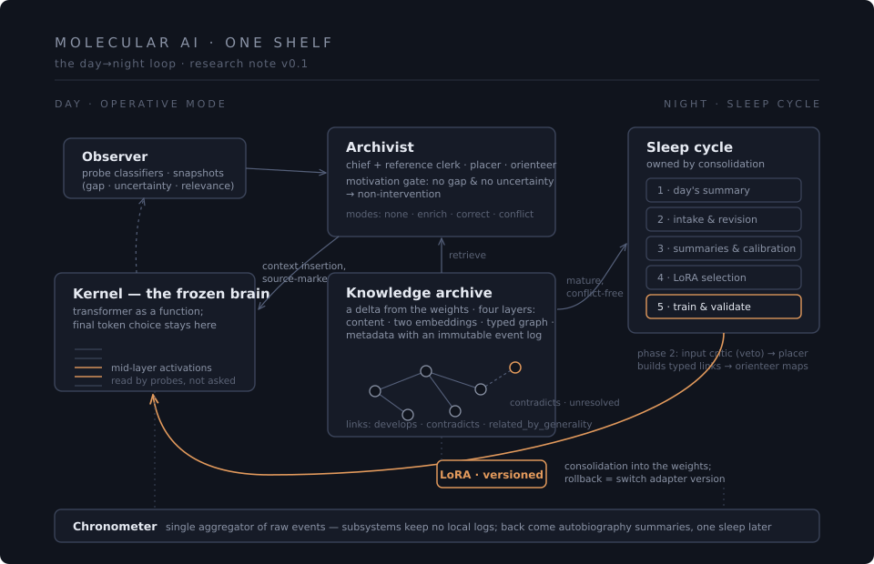

# Molecular AI — Research Notes

### Temporal plasticity for a frozen brain

> The transformer is the brain; Molecular AI is the organism.

> Five of the six properties of living intelligence are already inside
> the frozen transformer — implicitly. The missing sixth is plasticity
> in time. This programme adds exactly that, as an external
> architecture of processes.

> The archive is a delta from the weights, not a knowledge base.
> Overload protection is selectivity at the entrance, not deletion
> after the fact.

**What this is.** An open research programme studying the continuously
running learning process as the living mechanism of intelligence — and
publishing its state honestly, in the research-notes genre: what is
fixed, what is open, what is blocked, and which bets may fail.
Negative results count as results. The whole organism is designed to
run on an ordinary laptop (Hardware Humble).

**What this is not.** Not a product, not an MVP, not an AGI attempt,
not a competitor to LLM companies, and **not yet another RAG
framework** — degeneration into "query → embedding → search → LLM" is
treated as a documented failure mode with a dedicated defence
discipline.

## Documents

* [English edition](./temporal-plasticity-for-a-frozen-brain.md) — the
  public version.
* [Русский оригинал](./temporal-plasticity-for-a-frozen-brain.ru.md) —
  the source text; in case of divergence, the original governs.

## Inside the note

The metathesis (a process, not an architecture) · six testable
theses · complementary learning systems as the theoretical anchor ·
the molecule (fact+context with an "NL + structural index" core;
status as a fold over an immutable event log) · the organism of one
shelf (the observer as interoception; the Archivist with a motivation
gate; the night pipeline with typed links and queues; veto asymmetry
of the critics; the single aggregator; the five-phase sleep cycle) ·
the shelves frame · method and current state (the executable
specification; preliminary probe-scan numbers; a maturity map) · six
open problems, starting with the one that blocks the next pass · an
invitation to criticise.

## Status

Conceptual design with first empirical probes. Twelve architecture
passes completed and fixed; the inter-shelf pass is blocked by an
honest contradiction (see §8 of the note). The programme's code & data
repository — the executable specification and the experiment
materials — is being prepared for publication.

The most useful thing you can leave here is **criticism**: open an
issue or a discussion with an objection to any thesis, a counterexample
to the maturity map, or a pointer to work we have missed.

## Related

* [Afferent OS](https://github.com/rybkagreenbelin-png/afferent-os) —
  a companion concept note by the same author: the operating system
  as the AI's body. Its afferent perception and learning loop connect
  to this programme's chronicler and single-aggregator principle.

## License & authorship

Text and figures — [CC BY 4.0](./LICENSE). Citation metadata —
[CITATION.cff](./CITATION.cff).

**Authorship note.** This repository is a product of dialogic
co-authorship with asymmetric responsibility: the ideas and
formulations that constitute the research programme are the author's;
development, critique, and landscape mapping emerged in dialogue with
an AI assistant (Claude, Anthropic). Responsibility for the content
rests with the human author.

---

*Research notes · July 2026 · v0.1*
